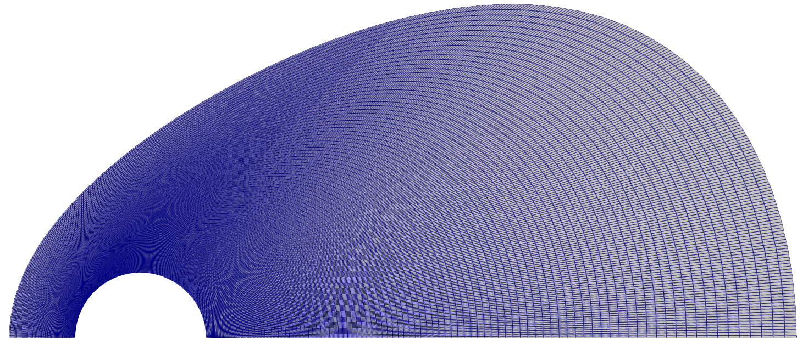
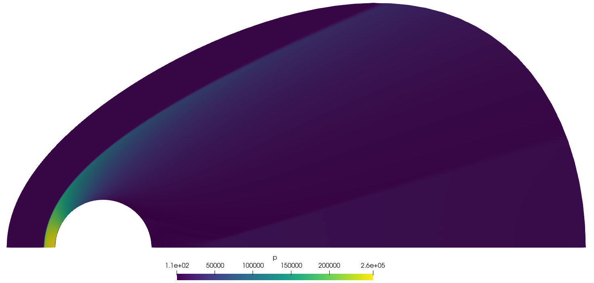
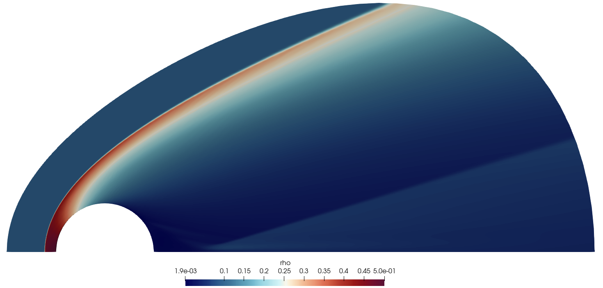
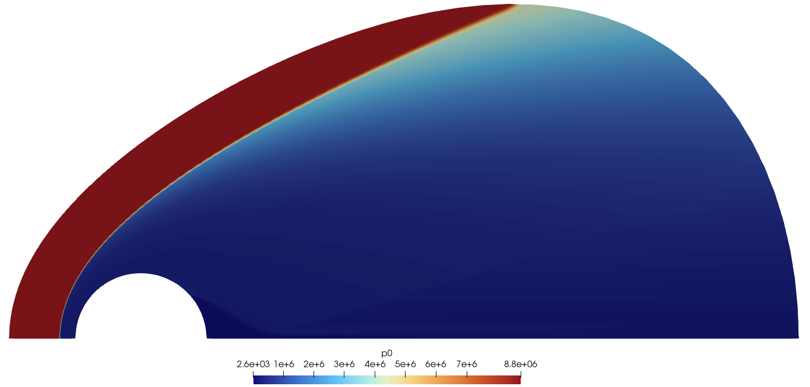
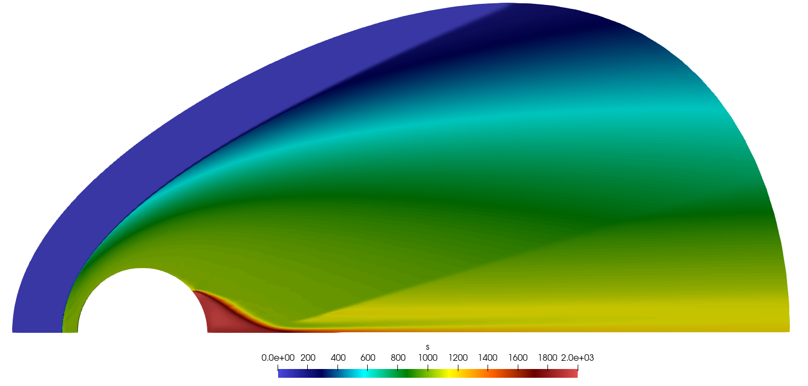
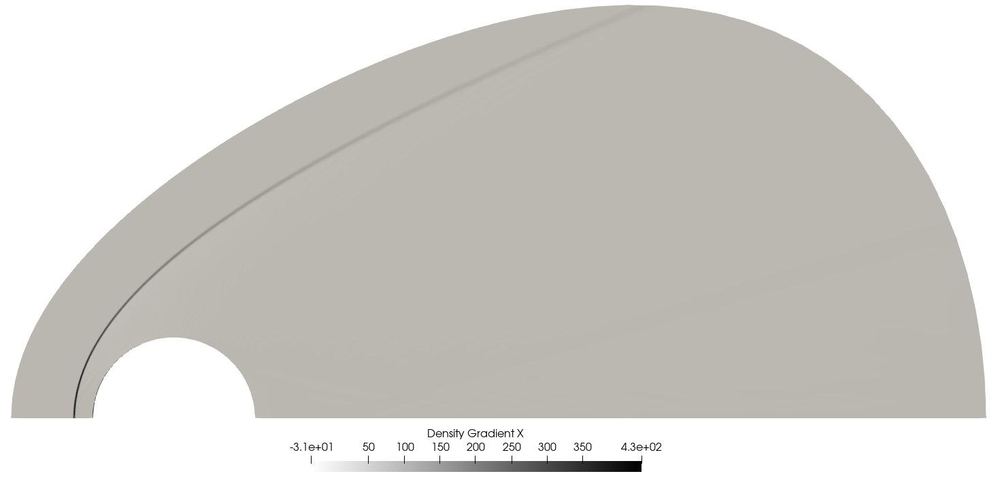
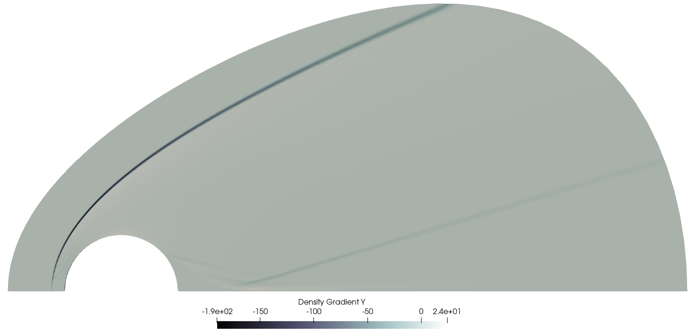

---
{
  "title": "Flow around a cylinder at Mach 6",
  "category": "research",
  "type": "coursework",
  "status": "Completed",
  "thumbnail": "assets/media/work_assets_hypersonics/hero-2-cylinder-mach.png",
  "media_type": "carousel",
  "institution": "IOE Pulchowk Campus",
  "date": "2026",
  "tags": [
    "rhoCentralFoam",
    "Hypersonics",
    "Local-Inclination Methods"
  ],
  "supporting_media": [
    "assets/media/work_assets_hypersonics/support-cylinder-temperature.png"
  ],
  "links": [
    {
      "label": "Python script",
      "url": "/assets/downloads/hypersonics/cp_dist.py"
    }
  ],
  "media_fit": "contain",
  "hero_interval": 4500,
  "hero_slides": [
    {
      "src": "assets/media/work_assets_hypersonics/hero-2-cylinder-mach.png",
      "caption": "Mach number field around the M∞ = 6 cylinder"
    },
    {
      "src": "assets/media/work_assets_hypersonics/support-cylinder-streamlines.png",
      "caption": "Streamlines around the cylinder and its leeward recirculation"
    }
  ],
  "order": 4,
  "card_title": "Flow around a cylinder",
  "card_thumbnail": "assets/media/work_assets_hypersonics/hero-2-cylinder-mach.png",
  "thumbnail_fit": "contain",
  "description": "Pressure distribution and flow around a circular cylinder at Mach 6, comparing local-inclination predictions with inviscid CFD at ISA 20 km freestream conditions."
}
---

This study compares local-inclination pressure predictions with an inviscid CFD solution for a circular cylinder at Mach 6. The detached bow shock, surface pressure distribution and leeward flow provide a useful test of what a simple surface-based model can capture, and where a resolved flow field adds information.

## Freestream conditions and assumptions

The calculations use the report's ISA 20 km freestream conditions and a calorically perfect gas.

| Quantity | Value |
| --- | --- |
| Freestream Mach number | 6 |
| Static pressure | 5,529 Pa |
| Density | 0.088 kg/m³ |
| Static temperature | 216.65 K |
| Speed of sound | Approximately 295 m/s |
| Dynamic viscosity | Approximately $1.42\times10^{-5}$ Pa·s |
| Specific-heat ratio, $\gamma$ | 1.4 |
| Specific heat, $c_p$ | 1,004.5 J/(kg·K) |

The CFD comparison is inviscid, with slip walls. Temperature contours describe the gas state; they do not constitute a prediction of viscous surface heat transfer.

## Analytical pressure models

Pressure is compared using

$$
C_p=\frac{p-p_\infty}{\tfrac12\rho_\infty V_\infty^2}
=\frac{2}{\gamma M_\infty^2}\left(\frac{p}{p_\infty}-1\right).
$$

The plotted surface coordinate $\theta$ runs from the stagnation point towards the rear of the cylinder. The local windward inclination used in the script is $\delta=\pi/2-\theta$.

### Modified Newtonian theory

The local pressure follows the squared sine of the surface inclination:

$$
C_p=C_{p,\max}\sin^2\delta,\qquad
C_{p,\max}=\frac{2}{\gamma M_\infty^2}
\left(\frac{p_{02}}{p_\infty}-1\right).
$$

Here $p_{02}$ is the stagnation pressure reached after a normal shock and subsequent isentropic deceleration. This is the modified Newtonian normalization described in the [IIT Guwahati/NPTEL hypersonic-flow notes](https://archive.nptel.ac.in/content/storage2/courses/101103004/module4/lec8/4.html). For $M_\infty=6$ and $\gamma=1.4$, the normal-shock and isentropic relations give $C_{p,\max}\approx1.8181$.

### Tangent-wedge method

Each windward surface element is treated as a wedge. Its local inclination supplies the deflection angle in the oblique-shock relation. Solving for the weak shock angle gives a pressure ratio and hence $C_p$. The archived implementation uses a limiting coefficient where an attached weak-shock solution is unavailable, and sets the tangent-wedge pressure coefficient to zero on the leeward side.

This approximation is most directly applicable where the surface locally resembles a wedge. Near the cylinder nose, the detached bow shock cannot be represented by a sequence of independent attached wedge shocks.

### Shock-expansion method

The calculation begins from a compressed windward state and marches through changes in surface angle using the Prandtl-Meyer function:

$$
\nu(M)=\sqrt{\frac{\gamma+1}{\gamma-1}}
\tan^{-1}\sqrt{\frac{\gamma-1}{\gamma+1}(M^2-1)}
-\tan^{-1}\sqrt{M^2-1}.
$$

An expansion through $|\Delta\delta|$ increases $\nu$ by that amount. The new Mach number is found numerically, and pressure follows from the isentropic pressure relation. Unlike the other archived curves, the shock-expansion curve continues into the leeward region and gives a small negative $C_p$ there.

## CFD setup

| Setting | Cylinder case |
| --- | --- |
| Solver | OpenFOAM `rhoCentralFoam` |
| Convective flux | Kurganov-Tadmor |
| Reconstruction | van Leer |
| Maximum Courant number | 0.4 |
| Cell count | Approximately 40,000 |
| Wall treatment | Slip |
| Initial field | A `sonicFoam` solution |

The domain is pear-shaped so mesh lines can follow the bow-shock region. The report uses centreline symmetry. This concentrates resolution around the strong compression near the front of the body while retaining the downstream wake region.

<figure><figcaption>The cylinder mesh used in the reported calculation.</figcaption></figure>

## Flow field and bow shock

<vtk-reader href="/content/data/hypersonics/cylinder.vtp" field="user-defined" colormap="user-defined" initial-colormap="rainbow" interactive="true" clipping="true" threshold="true" height="560"></vtk-reader>

The viewer contains a two-dimensional mid-plane from the actual CFD solution. Switch among Mach number, pressure, temperature and density; clipping and threshold controls help isolate the shock and high-compression region. The still figures remain available for comparison and full-resolution inspection.

<figure>

<figcaption>Static pressure and density rise across the detached bow shock, with the strongest compression near the nose.</figcaption></figure>

## Surface-pressure comparison

<plotly-chart href="/content/data/hypersonics/cylinder_cp_comparison.json" type="scatter" title="Cylinder pressure coefficient: archived calculations and CFD" height="420"></plotly-chart>

The chart retains the submitted numerical curves. The CFD dataset gives $C_p=1.81948$ at the stagnation-point sample. The archived analytical curves start at $1.62037$, approximately 10.94% below that value.

**Normalization matters here.** The archived `cp_dist.py` uses static pressure immediately behind a normal shock in its limiting coefficient. Modified Newtonian theory instead uses the post-shock stagnation pressure. Therefore the plotted nose discrepancy should not be presented as an intrinsic 11% error of correctly normalized modified Newtonian theory. The properly normalized coefficient of approximately 1.8181 is close to the CFD stagnation value, although that check alone does not validate the whole surface distribution.

Across the windward face, the archived Newtonian curve reproduces the broad pressure-distribution shape. The tangent-wedge and shock-expansion constructions provide a different local approximation around the shoulder, where the surface angle is smaller. Their behaviour near the nose also depends on the limiting-state treatment used in the script.

## Entropy layer and leeward flow

Different streamlines encounter different bow-shock strengths. The resulting entropy variation is relevant to the rotational flow behind a curved shock. Crocco's relation provides the connection:

$$
\mathbf{V}\times\boldsymbol{\omega}=\nabla H_0-T\nabla s.
$$

<figure>

<figcaption>Total pressure and entropy change distinguish shock losses from the static-pressure rise.</figcaption></figure>

The computed streamlines show a recirculating leeward region. Entropy gradients offer a physical interpretation, but this inviscid calculation does not resolve a viscous boundary layer or establish a viscous separation mechanism.

<figure>

<figcaption>Numerical schlieren from the streamwise and transverse density derivatives highlights the shock structure.</figcaption></figure>

## Reproduce the analytical comparison

The [archived pressure-distribution script](/assets/downloads/hypersonics/cp_dist.py) uses NumPy, pandas and SciPy. It writes `cylinder_Cp.csv`, containing the surface angle, local inclination and three analytical pressure coefficients. The CFD curve is a separate dataset; running this script does not recreate the CFD solution.

The archived script is retained as submitted, including the normalization noted above. A revised comparison should update that normalization explicitly and distinguish the revised curves from the original submission.

## Scope and next steps

This is a comparison of one inviscid calculation with inexpensive analytical models. A grid-convergence study is needed before assigning numerical uncertainty to the pressure differences. Viscous flow, surface heat flux and temperature-dependent gas properties would require additional modelling. The useful outcome is a clear separation between the resolved bow-shock/wake structure and the assumptions embedded in each local pressure model.

## Related studies

- [Shock-shock interactions](/work/shock-shock-interactions/)
- [Scramjet intake](/work/scramjet-intake/)
