---
{
  "title": "Scramjet intake design at Mach 6",
  "category": "research",
  "type": "coursework",
  "status": "Completed",
  "thumbnail": "assets/media/work_assets_hypersonics/hero-3-intake-geometry.png",
  "media_type": "carousel",
  "institution": "IOE Pulchowk Campus",
  "date": "2026",
  "tags": [
    "rhoCentralFoam",
    "Scramjet Intake Design",
    "Oblique Shocks",
    "RANS"
  ],
  "supporting_media": [],
  "links": [
    {
      "label": "Python script",
      "url": "/assets/downloads/hypersonics/intake.py"
    }
  ],
  "media_fit": "contain",
  "hero_interval": 4500,
  "hero_slides": [
    {
      "src": "assets/media/work_assets_hypersonics/hero-3-intake-geometry.png",
      "caption": "Single-ramp scramjet intake, sized from oblique-shock design"
    },
    {
      "src": "assets/media/work_assets_hypersonics/support-rans-intake-mach.png",
      "caption": "RANS Mach number field with boundary-layer growth and shock impingement"
    }
  ],
  "order": 4.2,
  "card_title": "Scramjet intake",
  "card_thumbnail": "assets/media/work_assets_hypersonics/hero-3-intake-geometry.png",
  "thumbnail_fit": "contain",
  "description": "Oblique-shock design and CFD validation of a single-ramp scramjet intake at Mach 6, comparing inviscid and RANS solutions at ISA 20 km freestream conditions."
}
---

This project designs a single-ramp scramjet intake for Mach 6 and compares its inviscid and RANS flow fields. The intake uses a ramp shock followed by a cowl shock to compress the flow before the isolator. The design exercise links shock relations, geometry and pressure recovery, then examines how boundary-layer growth changes the ideal flow pattern.

## Design requirements and freestream

| Quantity | Value |
| --- | --- |
| Flight Mach number | 6 |
| Freestream static pressure | 5,529 Pa |
| Freestream density | 0.088 kg/m³ |
| Freestream static temperature | 216.65 K |
| Specific-heat ratio | 1.4 |
| Target overall static-pressure ratio | 20 |
| Isolator height | 50 mm |
| Nominal design total-pressure recovery | 0.50 |

The static-pressure target refers to the overall compression across both shocks. Increasing static pressure is useful for the intake, but the associated total-pressure loss is a separate performance measure.

## Oblique-shock design method

For each shock, the weak-branch shock angle is obtained from the $\theta$-$\beta$-$M$ relation:

$$
\tan\theta=
\frac{2\cot\beta\left(M^2\sin^2\beta-1\right)}
{M^2\left(\gamma+\cos2\beta\right)+2}.
$$

The static-pressure jump is

$$
\frac{p_2}{p_1}=1+\frac{2\gamma}{\gamma+1}
\left(M^2\sin^2\beta-1\right).
$$

The downstream Mach number from the ramp shock is used as the upstream state for the cowl shock. The design script iterates on the common turning-angle magnitude until

$$
\pi=\frac{p_3}{p_1}=\frac{p_2}{p_1}\frac{p_3}{p_2}=20.
$$

With constant total temperature, overall recovery can be written as

$$
\frac{p_{03}}{p_{01}}=
\frac{p_3}{p_1}
\left(\frac{1+\tfrac{\gamma-1}{2}M_3^2}
{1+\tfrac{\gamma-1}{2}M_1^2}\right)^{\gamma/(\gamma-1)}.
$$

The equations use the perfect-gas shock relations summarized by [NASA Glenn](https://www.grc.nasa.gov/WWW/BGH/oblique.html). This design uses two sequential oblique shocks in a single-ramp intake; applying the full pressure ratio of 20 to only the first shock would describe a different calculation.

## Geometry and reproducible design values

<figure>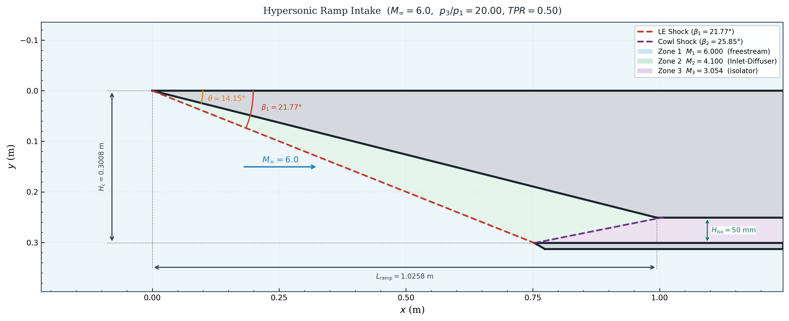<figcaption>The ramp and shock-line intersections set the capture geometry and isolator entrance.</figcaption></figure>

The report records a ramp length of approximately 1.026 m and a capture height of 0.301 m. In the archived script, the line-intersection calculation uses

$$
m=\tan(\theta-\beta_2),\qquad
x_s=\frac{h_{\mathrm{iso}}(m-\tan\beta_1)}
{m(\tan\beta_1-\tan\theta)},\qquad
L_{\mathrm{ramp}}=\frac{x_s}{\cos\theta}.
$$

Running the archived `intake.py` with its original inputs gives:

| Quantity | Script output |
| --- | --- |
| Ramp angle | 14.1550° |
| Leading-edge shock angle | 21.7743° |
| Cowl shock angle | 25.8538° |
| Ramp length | 1.02575 m |
| Total-pressure recovery | 0.50425 |

These are reproduced script values. The report's geometry table lists a cowl angle of 26.15° and uses a nominal recovery of 0.50. Those values should not be silently treated as identical to the script output. The CFD performance comparison below retains the nominal design values reported in the study.

## CFD setup

| Setting | Inviscid | RANS |
| --- | --- | --- |
| Solver | `rhoCentralFoam` | `rhoCentralFoam` |
| Flux / reconstruction | Kurganov-Tadmor / van Leer | Kurganov-Tadmor / van Leer |
| Cell count | Approximately 190,000 | Approximately 190,000 |
| Mesh generator | `blockMesh` | `blockMesh` |
| Turbulence model | None | $k$-$\omega$ SST |
| Wall boundary condition | Slip | No-slip, adiabatic |
| Time step | Adaptive, maximum Courant number 0.4 | Adaptive, maximum Courant number 0.4 |

The structured mesh is refined near the ramp wall and the oblique-shock region. The RANS case adds viscous wall effects to the same intake geometry; the adiabatic boundary condition does not supply a cooled-wall heat-transfer study.

<figure>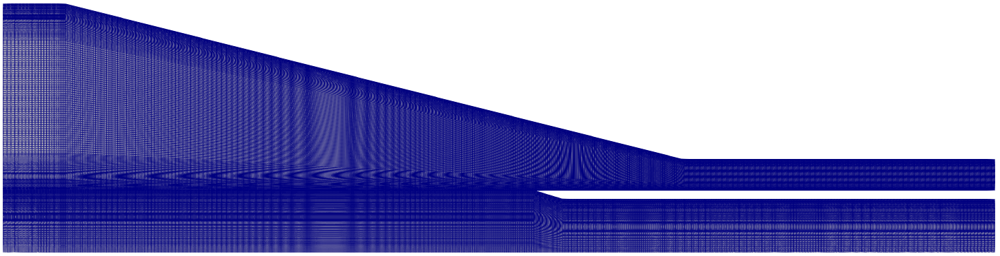<figcaption>The approximately 190,000-cell intake mesh.</figcaption></figure>

## Inviscid shock structure

<vtk-reader href="/content/data/hypersonics/intake.vtp" field="user-defined" colormap="user-defined" initial-colormap="rainbow" interactive="true" clipping="true" threshold="true" height="540"></vtk-reader>

The leading-edge shock compresses and turns the incoming stream. The cowl shock produces a second compression and turns it towards the isolator direction. The interactive field contains the inviscid result; it should not be mistaken for the RANS solution shown later.

<figure>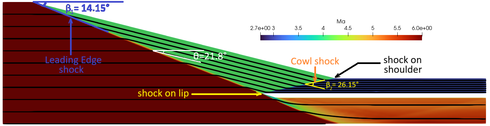<figcaption>The inviscid flow features and intended shock-impingement geometry.</figcaption></figure>

<figure>
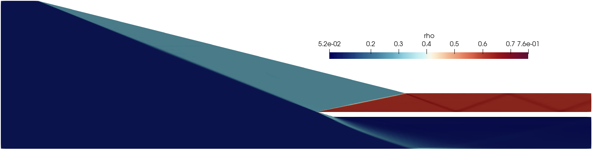
<figcaption>Static pressure and density show the successive compression regions.</figcaption></figure>

<figure>
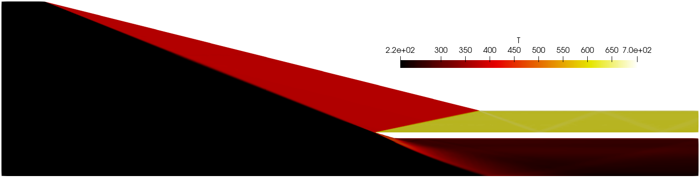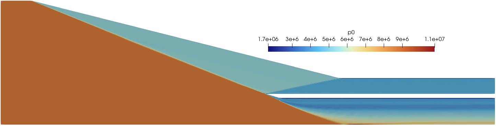
<figcaption>Static-temperature rise accompanies compression, while total pressure decreases across the shocks.</figcaption></figure>

## Pressure recovery and nominal design comparison

<figure>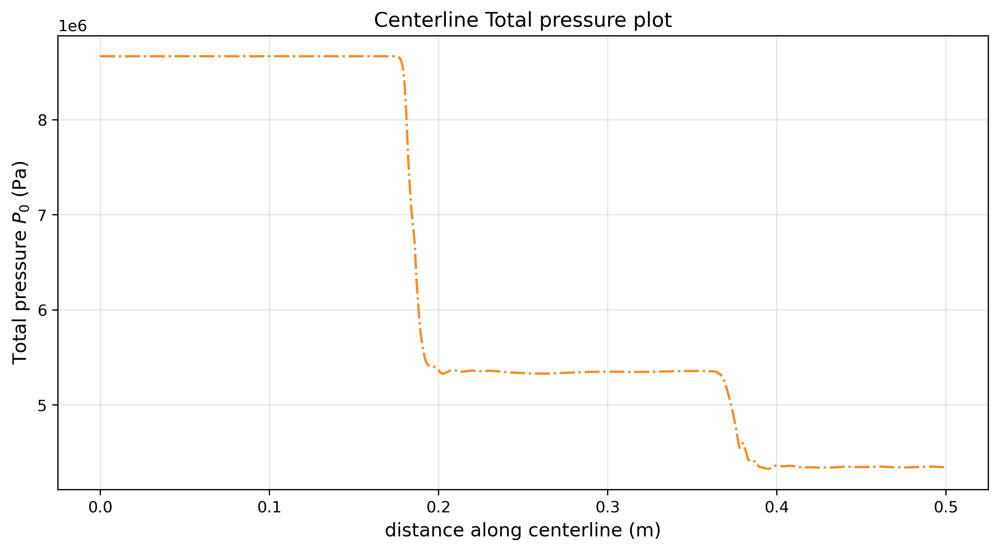<figcaption>The centreline profile identifies the two principal shock-related pressure losses. The performance values below are those reported at the isolator exit.</figcaption></figure>

| Performance quantity | Nominal design in report | Inviscid CFD | Reported deviation |
| --- | --- | --- | --- |
| Total-pressure recovery | 0.5000 | 0.5013 | +0.26% |
| Static-pressure ratio | 20.000 | 19.928 | -0.36% |

The reported deviations are within 0.4% of those nominal targets. This is a consistency check between an inviscid design method and an inviscid calculation using the same perfect-gas framework, not experimental validation. The unrounded script recovery of 0.50425 is listed separately above so its difference from the nominal table remains visible.

<figure>
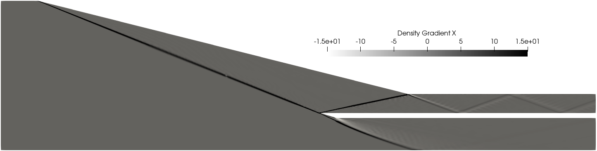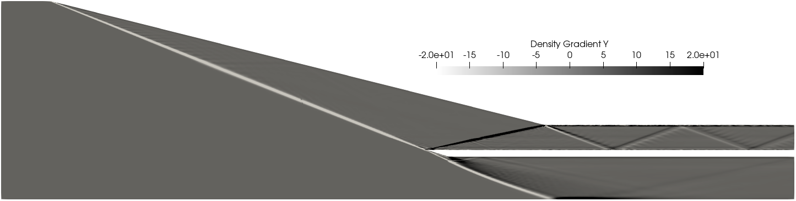
<figcaption>Numerical schlieren isolates the two shock systems and downstream density-gradient features.</figcaption></figure>

## RANS: boundary-layer displacement and separation

<figure>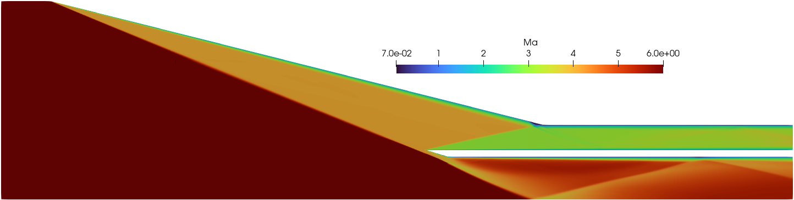<figcaption>The viscous solution changes the effective flow passage relative to the slip-wall calculation.</figcaption></figure>

<figure>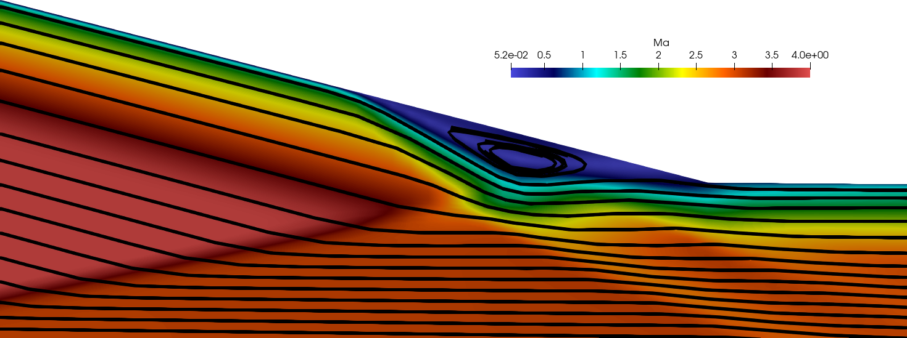<figcaption>Streamlines provide a closer view of the near-wall flow in the RANS result.</figcaption></figure>

The report identifies a thickened boundary layer near the shoulder and a small separation bubble around cowl-shock impingement. Displacement of the outer flow changes the effective compression geometry, and the shock no longer lands exactly where the ideal slip-wall design places it.

The $k$-$\omega$ SST calculation is fully turbulent. It does not establish where transition occurs, and no separate quantitative RANS recovery value is given in the source comparison. The contour images support a flow-structure comparison without supplying an additional measured performance percentage.

## Reproduce the design calculation

The [intake design script](/assets/downloads/hypersonics/intake.py) uses Python's standard `math` module. Its inputs are `M1`, `PI` and `H_ISO` near the top of the file. It solves for the ramp angle, computes both shock states, obtains the ramp length from the line intersections and prints the recovery. It does not generate a mesh or run OpenFOAM.

## Next questions

Distributing compression over additional ramps could reduce the loss associated with stronger individual shocks, with added length and geometric complexity. For this geometry, the immediate follow-ups are mesh sensitivity, a consistent set of design-script and CFD geometry values, transition sensitivity, and a more complete viscous performance comparison. These are the questions needed to move from an internally consistent inviscid design towards a more complete intake assessment.

## Related studies

- [Flow around a cylinder](/work/flow-around-cylinder/)
- [Shock-shock interactions](/work/shock-shock-interactions/)
