---
{
  "title": "Shock-shock interactions at Mach 3",
  "category": "research",
  "type": "coursework",
  "status": "Completed",
  "thumbnail": "assets/media/work_assets_hypersonics/hero-1-typeII-mach-interaction.png",
  "media_type": "carousel",
  "institution": "IOE Pulchowk Campus",
  "date": "2026",
  "tags": [
    "rhoCentralFoam",
    "Shock Polars",
    "Shock-Shock Interaction"
  ],
  "supporting_media": [
    "assets/media/work_assets_hypersonics/support-typeII-mach-field.png",
    "assets/media/work_assets_hypersonics/support-typeI-total-pressure.png"
  ],
  "links": [
    {
      "label": "Python script",
      "url": "/assets/downloads/hypersonics/shockPolar.py"
    }
  ],
  "media_fit": "contain",
  "hero_interval": 4500,
  "hero_slides": [
    {
      "src": "assets/media/work_assets_hypersonics/hero-1-typeII-mach-interaction.png",
      "caption": "Type II (Mach) interaction at M∞ = 3 - Mach stem, triple point, and slipstream"
    },
    {
      "src": "assets/media/work_assets_hypersonics/hero-4-typeI-regular-reflection.png",
      "caption": "Type I (regular) reflection, no Mach stem"
    }
  ],
  "order": 4.1,
  "card_title": "Shock-shock interactions",
  "card_thumbnail": "assets/media/work_assets_hypersonics/hero-1-typeII-mach-interaction.png",
  "thumbnail_fit": "contain",
  "description": "Shock-polar predictions and CFD of intersecting oblique shocks at Mach 3, comparing regular and Mach interactions at ISA 20 km freestream conditions."
}
---

Two opposed-ramp configurations at Mach 3 were used to compare shock-polar predictions with resolved CFD. The central question is whether the incident shocks can interact through a regular pattern or require a Mach stem and triple points. In this study, **Type I** denotes the ±15° ramp case and **Type II** denotes the ±30° case.

## Freestream and numerical setup

Both cases use the same ISA 20 km freestream state: static pressure 5,529 Pa, density 0.088 kg/m³ and temperature 216.65 K. The perfect-gas calculation uses $\gamma=1.4$, with a freestream Mach number of 3.

| Setting | Type I | Type II |
| --- | --- | --- |
| Ramp deflections | ±15° | ±30° |
| Cell count | Approximately 33,000 | Approximately 40,500 |
| Reported Kantrowitz area ratio | 1.147 | 1.38 |
| Solver | `rhoCentralFoam` | `rhoCentralFoam` |
| Flux / reconstruction | Kurganov-Tadmor / van Leer | Kurganov-Tadmor / van Leer |
| Maximum Courant number | 0.4 | 0.4 |
| Wall treatment | Slip, adiabatic | Slip, adiabatic |

<figure>
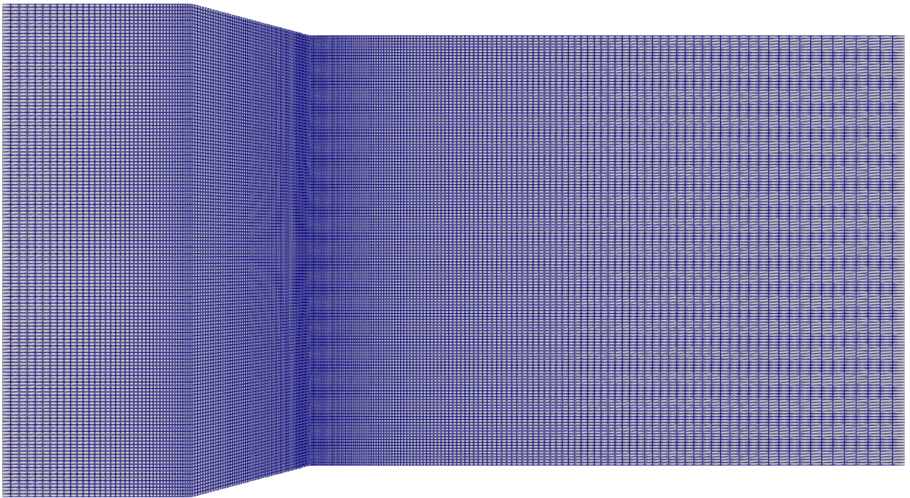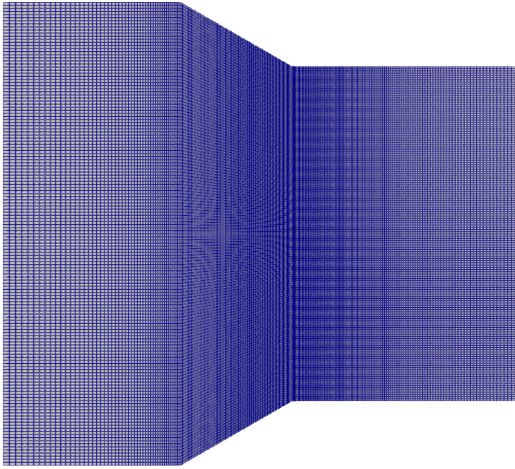
<figcaption>Meshes for the Type I and Type II ramp configurations.</figcaption></figure>

## Building the shock polars

The oblique-shock relations connect upstream Mach number $M_1$, flow deflection $\theta$ and shock angle $\beta$:

$$
\tan\theta=
\frac{2\cot\beta\left(M_1^2\sin^2\beta-1\right)}
{M_1^2\left(\gamma+\cos2\beta\right)+2}.
$$

For each admissible $\beta$, the static-pressure ratio is

$$
\frac{p_2}{p_1}=1+\frac{2\gamma}{\gamma+1}
\left(M_1^2\sin^2\beta-1\right).
$$

These standard perfect-gas relations are summarized in [NASA Glenn's oblique-shock reference](https://www.grc.nasa.gov/WWW/BGH/oblique.html). Plotting pressure ratio against turning angle produces a shock polar. After an incident shock, a second polar is constructed using the downstream Mach number and shifted by the flow's existing deflection and pressure rise.

The compatibility check asks whether the downstream states can reach a common pressure and compatible direction through the weak-shock branches. This gives a prediction to compare with the CFD pattern, rather than classifying the interaction only after looking at a contour plot.

<figure>
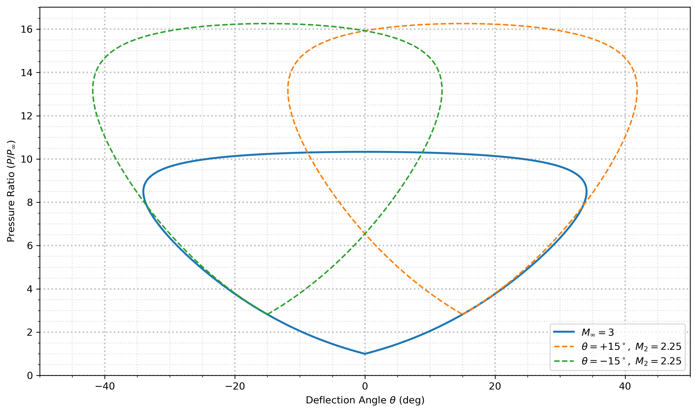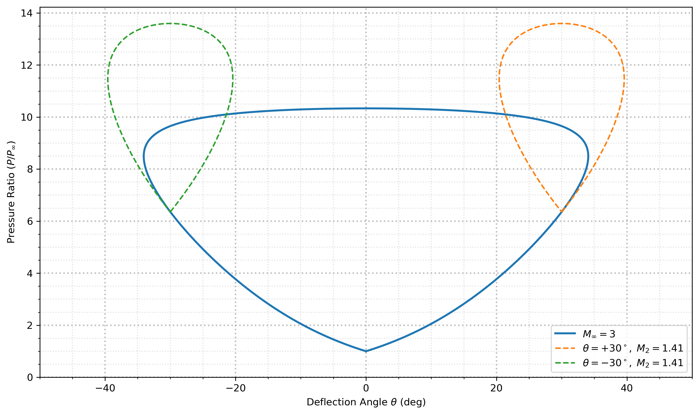
<figcaption>The reported polar constructions predict a regular interaction for the smaller ramp angles and a Mach interaction for the larger angles.</figcaption></figure>

## Duct starting check

The report compares the two area ratios with a Kantrowitz starting limit of 1.39. Both are below that value, although the Type II ratio of 1.38 is close to it. This is a starting criterion used for these configurations; it is not a universal area-ratio limit for every inlet.

Checking starting conditions matters because a standing normal shock near the entrance would change the upstream state and prevent a direct comparison with the intended incident-shock construction. Satisfying the reported criterion is a preliminary check, not a substitute for a transient inlet-starting study.

## Type I: regular interaction

<vtk-reader href="/content/data/hypersonics/typeI.vtp" field="user-defined" colormap="user-defined" initial-colormap="rainbow" interactive="true" clipping="true" threshold="true" height="540"></vtk-reader>

At ±15°, the incident shocks meet and form a regular interaction without a Mach stem. The streamline view shows the incident and outgoing waves; pressure, density and entropy provide complementary ways to locate them.

<figure>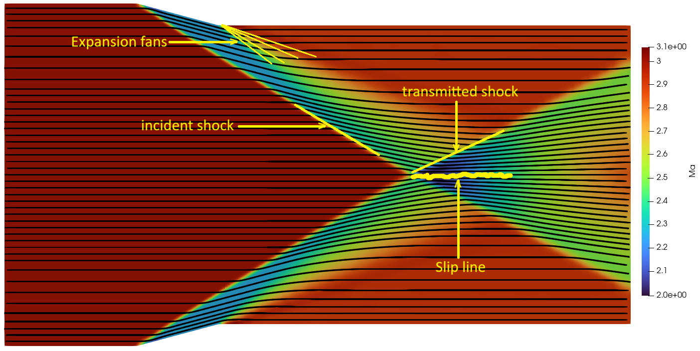<figcaption>Flow features in the smaller-deflection configuration.</figcaption></figure>

<figure>
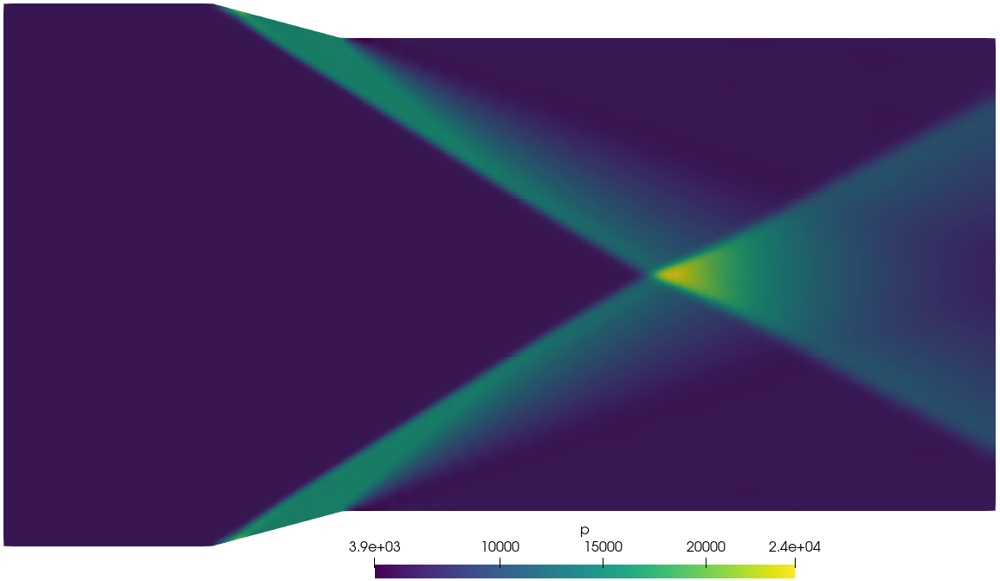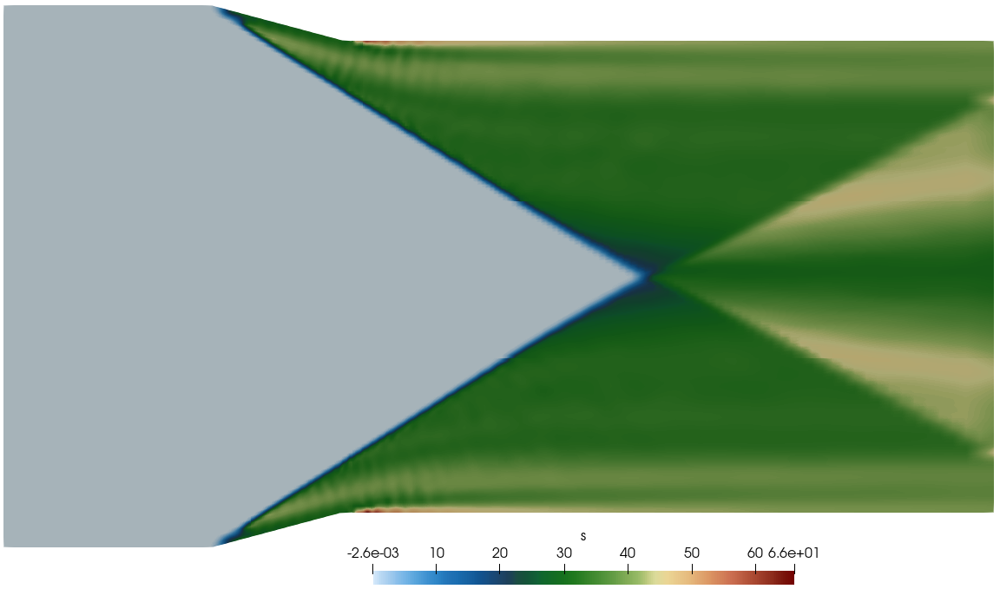
<figcaption>The entropy contour helps reveal the narrow slip-line feature discussed in the report.</figcaption></figure>

The regular interaction avoids the strong, near-normal stem seen in the second case. That does not imply zero total-pressure loss: the oblique shocks themselves also generate entropy and reduce total pressure.

<figure>
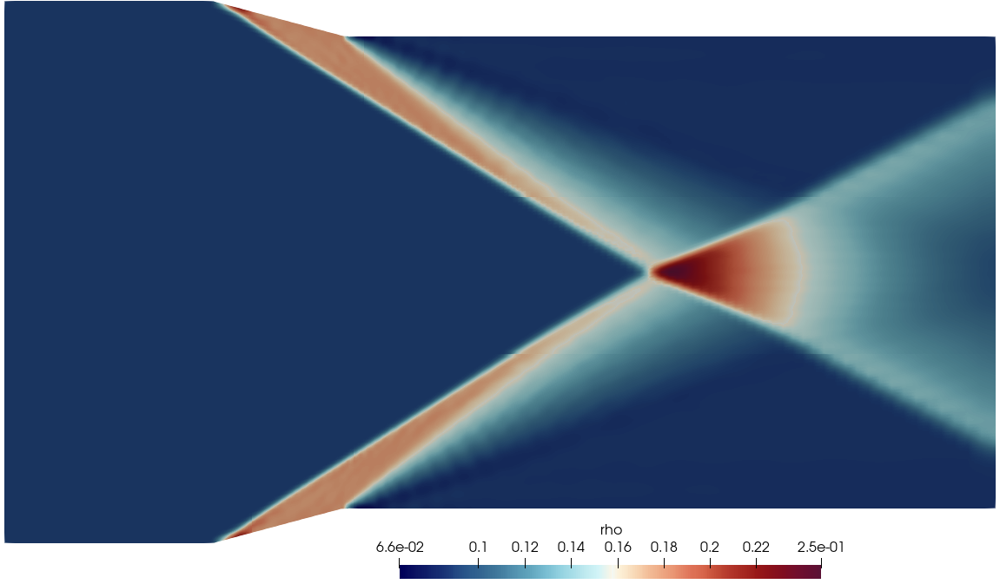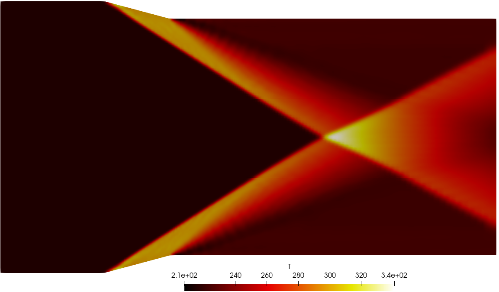
<figcaption>Density and temperature fields for Type I.</figcaption></figure>

## Type II: Mach interaction

<vtk-reader href="/content/data/hypersonics/typeII.vtp" field="user-defined" colormap="user-defined" initial-colormap="rainbow" interactive="true" clipping="true" threshold="true" height="540"></vtk-reader>

At ±30°, the CFD shows a near-normal Mach stem spanning the channel centreline, with a triple point at each end. A subsonic pocket appears behind the stem, reflected shocks extend downstream, and slipstreams separate flow that has passed through different shock histories. In the viewer, the Mach-number field and a threshold near one help identify the subsonic region.

<figure>
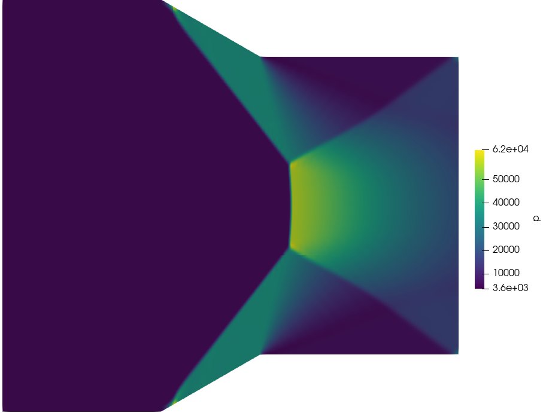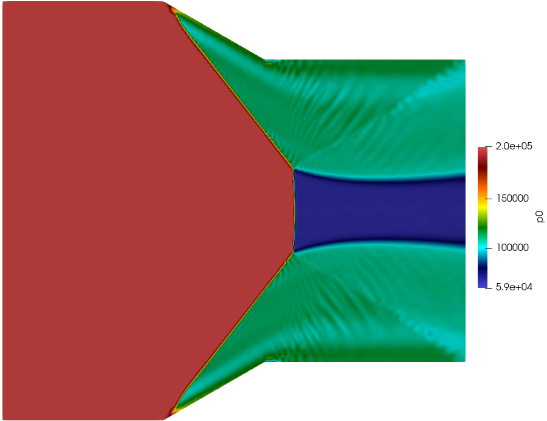
<figcaption>Static pressure and total pressure answer different questions: compression strength versus retained flow availability.</figcaption></figure>

<figure>
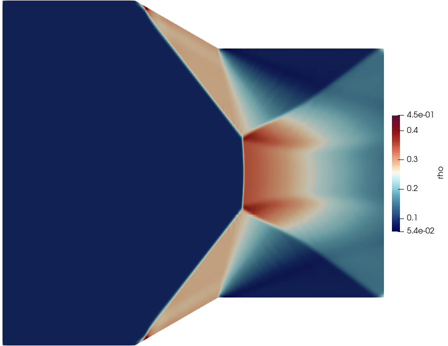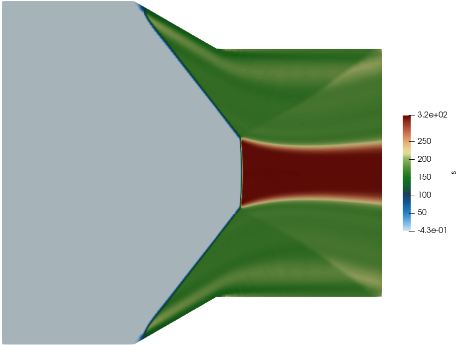
<figcaption>The stem produces a stronger density jump and entropy rise than the surrounding oblique shocks.</figcaption></figure>

Expansion regions emerging near the triple points interact with the downstream flow. They change the local Mach number but do not reverse the entropy production of the shocks.

## Numerical schlieren comparison

Density derivatives emphasize sharp wave features that can be less obvious on a full-range density contour. They are numerical visualizations of the computed field, not optical measurements.

<figure>
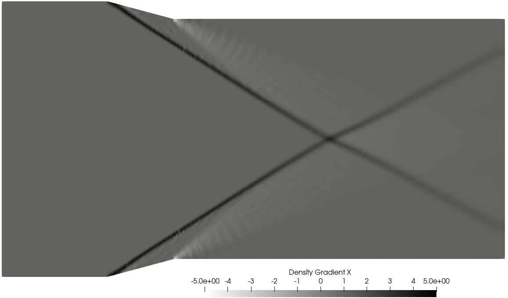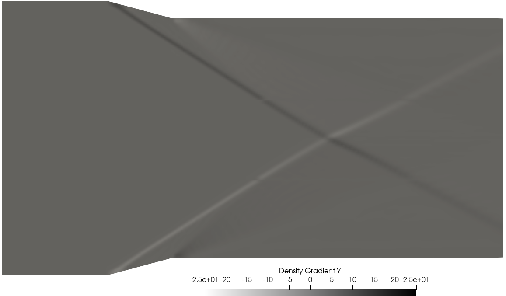
<figcaption>Type I: streamwise and transverse density-gradient views.</figcaption></figure>

<figure>
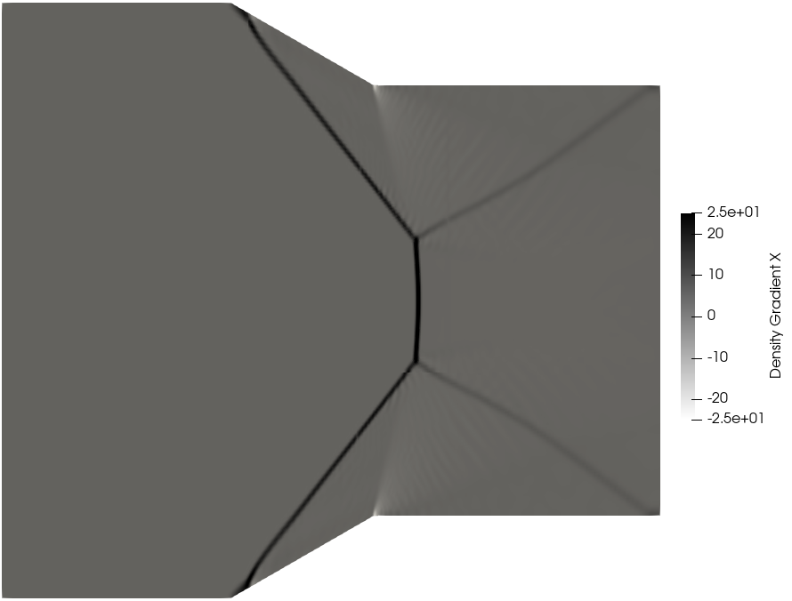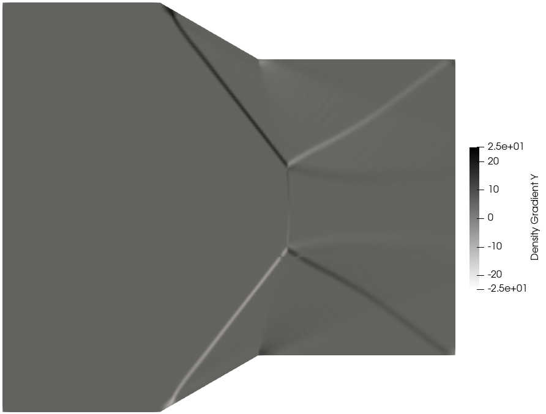
<figcaption>Type II: the stem, outgoing waves and downstream structure are visible in the density-gradient fields.</figcaption></figure>

## Reproduce the polar construction

The [shock-polar script](/assets/downloads/hypersonics/shockPolar.py) uses NumPy and Matplotlib. It defaults to $M_\infty=3$ and deflections of `[15, -15]`. Set those deflections to `[30, -30]` to construct the second case, and use a different output filename so the first figure is retained. The script builds incident and downstream polars; it does not run the CFD cases.

## Findings and limits

The predicted change in interaction pattern is supported by the two CFD solutions. The most useful comparison is the appearance of the stem, triple points, subsonic pocket and slipstreams, together with the stronger entropy and total-pressure changes in Type II.

Two ramp angles establish a comparison, not a resolved transition boundary. A finer sweep of ramp angle, mesh refinement at the interaction, and unsteady checks would be needed to investigate the transition and quantify sensitivity. Slip-wall calculations also omit shock/boundary-layer interaction.

## Related studies

- [Flow around a cylinder](/work/flow-around-cylinder/)
- [Scramjet intake](/work/scramjet-intake/)
